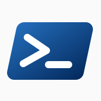

# Pyetro Sabaraense Ferreira da Costa ☕👨🏻‍💻

    

**`Desenvolvedor Full Stack`** Ingressei nessa área em 2008 na faculdade, começando meus primeiros bits de código em 2009.

Sou bacharel em Ciência da Computação pela Universidade de Marília e tenho atuação em ambientes corporativos, sistemas legados, integrações financeiras, plataformas educacionais, e-commerce e projetos de inovação.

Ao longo da minha trajetória, tive a oportunidade de trabalhar com equipes técnicas e áreas de negócio em soluções que exigem segurança, consistência dos dados e capacidade de manutenção. Gosto especialmente de lidar com desafios de integração, melhoria de arquitetura e transformação de sistemas complexos em soluções mais claras e eficientes.

---

### Estatísticas do GitHub

<a href="#">
  <picture>
    <source
      srcset="https://github-stats-extended.vercel.app/api?username=pyetrosafe&theme=nightowl&bg_color=30,011627,214567"
      media="(prefers-color-scheme: dark)"
    />
        
  </picture>
</a>
<a href="#">
  <picture>
    <source
      srcset="https://github-stats-extended.vercel.app/api?username=pyetrosafe&theme=nightowl&bg_color=30,011627,214567"
      media="(prefers-color-scheme: dark)"
    />
    
  </picture>
</a>

---

### Back-end

    
    
    
    
    
    
    
    
    
    

---

### Front-end

    
    
    
    
    
    
    
    

---

### Dados e infraestrutura

    
    
    
    
    
    
    
    
    

---

## Como tenho contribuído

Minha experiência passa por diferentes etapas da construção e manutenção de software:

- Desenvolvimento de aplicações web completas, do banco de dados à interface;
- Criação e manutenção de APIs REST e integrações entre sistemas;
- Desenvolvimento de microserviços e serviços em Java;
- Integração com APIs financeiras, incluindo operações como PIX e consultas bancárias;
- Desenvolvimento de endpoints que consomem APIs paginadas, com retries e registro de falhas;
- Criação e manutenção de procedures, views e jobs;
- Automação de processos e execução agendada de tarefas;
- Manutenção de sistemas legados e melhoria de código mal documentado ou organizado;
- Migração de funcionalidades, correções e implementação de novas regras de negócio;
- Desenvolvimento de sistemas educacionais, financeiros, comerciais e de gestão;
- Escrita de testes unitários automatizados;
- Uso de MVC, SOLID, Clean Code e padrões de projeto;
- Trabalho com Kanban, Scrum e implantação contínua de melhorias.

Também já lidei com consultas de alta carga, integrações SOAP e REST, autenticação, middleware, gerenciamento de políticas de privacidade e sistemas baseados em Delphi.

---

## Trajetória profissional

Minha carreira começou em 2009 com sistemas web de gestão de pátios veiculares, passando por manutenção e desenvolvimento em Delphi, PHP e JavaScript. Com o tempo, ampliei minha atuação para APIs, integrações, arquitetura e sistemas full stack em diferentes segmentos.

Entre os desafios que marcaram essa trajetória estão:

- liderar o desenvolvimento de uma API REST em Delphi;
- aprender Ruby on Rails em apenas duas semanas para atuar em um projeto;
- mentorar equipes e incentivar padrões de desenvolvimento;
- promover compartilhamento de conhecimento em projetos técnicos;
- atuar em áreas financeiras, Open Finance e investimentos;
- trabalhar com sistemas educacionais de alta complexidade;
- apoiar equipes em projetos especiais solicitados diretamente pela diretoria;
- migrar, corrigir e evoluir sistemas em operação.

Atualmente, atuo em desenvolvimento full stack na **Capgemini**, em projetos relacionados à área financeira, Open Finance e investimentos.

---

## Principais projetos pessoais

### [Winget](https://github.com/pyetrosafe/winget)

Automação da instalação de programas no Windows utilizando PowerShell e Windows Package Manager. O projeto ajuda a preparar novamente uma máquina após uma formatação, simplificando a instalação dos aplicativos.

### [Lara-ecommerce](https://github.com/pyetrosafe/lara-ecommerce)

Modelo de e-commerce desenvolvido em Laravel, com funcionalidades relacionadas a autenticação, banco de dados, validação e estruturação de uma aplicação full stack.

---

## Certificações e formação

- Certificação em PHP pela **Caelum**
- Bacharel em **Ciência da Computação** pela Universidade de Marília
- Inglês intermediário
- Português nativo

---

## Forma de trabalho

Sou um profissional organizado e proativo, com facilidade para resolver problemas, aprender novas tecnologias e trabalhar em equipe. Valorizo código legível, comunicação clara, boas práticas e soluções que sejam úteis não apenas na entrega imediata, mas também ao longo da evolução do sistema.

Atualmente, continuo buscando novos conhecimentos e desafios em desenvolvimento de software, arquitetura de aplicações, integrações e automação.

---

📍 Florianópolis, Santa Catarina, Brasil
💼 [LinkedIn](https://www.linkedin.com/in/pyetro-sabaraense)
